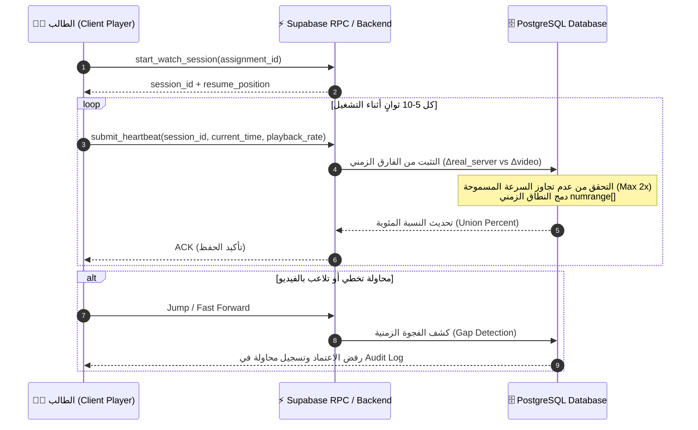

<div align="center">

# 🎓 OpenEdPuzzle | وصلة للتعلّم (WaslaLearn)

### **منصة التعلم التفاعلية بالفيديو والتحقق الذكي من التقدّم**
**Next-Generation Interactive Video Learning & Anti-Cheat Analytics Platform**

[](https://nextjs.org/)
[](https://react.dev/)
[](https://www.typescriptlang.org/)
[](https://supabase.com/)
[](https://tailwindcss.com/)
[](#license)

[نظرة عامة](#-نظرة-عامة--overview) •
[المميزات الرئيسية](#-المميزات-الرئيسية--key-features) •
[نظام منع الغش](#-نظام-منع-الغش-الذكي--anti-cheat-engine) •
[تقنيات المشروع](#-التقنيات-المستخدمة--tech-stack) •
[التثبيت والتشغيل](#-التثبيت-والتشغيل--getting-started) •
[معمارية قاعدة البيانات](#-معمارية-قاعدة-البيانات--database-architecture)

---

</div>

## 📌 نظرة عامة | Overview

**OpenEdPuzzle (WaslaLearn)** هي منصة تعليمية تفاعلية متطورة تسمح للمدرسين بتحويل أي فيديو تعليمي إلى تجربة تفاعلية مليئة بالألئلة والأسئلة التقييمية المنتشرة عبر خط الوقت (Video Timeline).

تتميز المنصة **بنظام محرك التحقق الذكي (Anti-Cheat Engine)** المبني بالكامل على مستواين (مستوى قاعدة البيانات PostgreSQL ومستوى الفرونت إند Client Heartbeats)، مما يضمن عدم إمكانية الغش أو تخطي الفيديو أو التلاعب بسجل المشاهدة، ويقدم للمعلم إحصائيات دقيقة بنسبة 100% لكل طالب.

---

## ✨ المميزات الرئيسية | Key Features

### 👨‍🏫 للمدرسين (Teacher Experience)
* 🎬 **محرر الفيديو التفاعلي (Interactive Video Builder):** إضافة أسئلة (اختيار من متعدد، أسئلة مفتوحة، ملاحظات) في نقاط زمنية محددة بدقة.
* 📊 **لوحة تحليلات متقدمة (Real-Time Analytics):** متابعة نسبة مشاهدة كل طالب، والإجابات، ونقاط التعثر، وخريطة التفاعل (Heatmap).
* 🛡️ **سجل مكافحة الغش (Security & Audit Logs):** كشف أي محاولات لتسريع الفيديو غير المصرح به، أو التلاعب بالوقت، أو الفتح من أجهزة متعددة.
* 🏫 **إدارة الصفوف والواجبات:** إنشاء فصول دراسية، توليد أكواد انضمام (Invite Codes)، وتعيين الواجبات بمواعيد تسليم محددة.

### 👨‍🎓 للطلاب (Student Experience)
* 📺 **مشغل فيديو تفاعلي ذكي (Smart Interactive Player):** يوقف الفيديو تلقائياً عند الوصول لسؤال ولا يسمح بالمتابعة إلا بعد الإجابة.
* 📍 **متابعة الإنجاز بدقة (Interval Union Progress):** حساب النسبة المئوية للمشاهدة الفعلية بناءً على الأجزاء المشاهدة حقيقةً فقط (حساب المجموعات المتداخلة `numrange[]`).
* 🔄 **الاستئناف الذكي (Smart Resume):** استكمال المشاهدة من آخر نقطة موثقة على السيرفر بدون فقدان أي جزء.
* 📱 **تجربة سلسة وسريعة:** واجهة مستخدم فائقة السرعة مع تأثيرات بصرية حديثة (GSAP + Lenis Smooth Scroll).

---

## 🛡️ نظام منع الغش الذكي | Anti-Cheat Engine

تعتمد معظم المنصات التقليدية على حفظ نسبة المشاهدة من خلال متصفح الطالب (Client-side)، مما يجعلها عرضة للتلاعب بسهولة. في **OpenEdPuzzle** تم بناء **محرك نبضات القلب (Heartbeat Engine)** مع منطق رياضي محكم:



### 💡 كيف يعمل منع الغش؟
1. **التحقق من الفارق الزمني الحقيقي (`Δreal_server`):** يتم حساب الفارق الزمني بناءً على ساعة السيرفر وليس ساعة جهاز الطالب.
2. **رياضيات دمج النطاقات (`numrange[] Union`):** يتم تسجيل الأجزاء المقطوعة كنطاقات زمنية `[start, end]`. إذا أعاد الطالب مشاهدة مقطع سابق، لا تُحسب له نقاط مضاعفة.
3. **منع الجلسات المتعددة (Concurrent Sessions):** لا يمكن فتح نفس الواجب من جهازين في نفس الوقت.
4. **حفظ نبضات القلب المباشرة (Beacon & Offline Queue):** في حال انقطاع النت، يتم تخزين النبضات محلياً وإرسالها بطريقة مشفرة ومحدودة فور عودة الاتصال.

---

## 🛠️ التقنيات المستخدمة | Tech Stack

| المجال | التقنية / المكتبة | الوصف |
| :--- | :--- | :--- |
| **Framework** | Next.js 15 (App Router) | إطار العمل الرئيسي بالجيل الخامس عشر |
| **Language** | TypeScript 5.9 | كتابة كود آمن ومحصن بالأنواع |
| **UI Library** | React 19 | أحدث إصدار من مكتبة ريآكت |
| **Styling** | Tailwind CSS + Radix UI | تصميم حديث ومكونات سهلة الوصول (Accessible) |
| **Animations** | GSAP 3 + Lenis Scroll | تحريك عالي الأداء وتصفح ناعم جداً |
| **State** | Zustand | إدارة الحالة المحلية بكل خفة وسرعة |
| **Backend & Database** | Supabase (PostgreSQL 15+) | قاعدة بيانات relational مع إمكانات RLS و RPC |
| **Notifications** | Sonner | تنبيهات تفاعلية جذابة |

---

## 📁 هيكل المشروع | Project Structure

```bash
OpenEdPuzzle/
├── 📁 app/                     # Next.js App Router Pages & Routes
│   ├── 📁 (landing)/           # الصفحة الرئيسية التسويقية (GSAP Animations)
│   ├── 📁 app/                 # تطبيق المنصة الرئيسي
│   │   ├── 📁 student/         # لوحة تحكم الطالب (الفصول والتقدم)
│   │   ├── 📁 teacher/         # لوحة تحكم المدرس (إدارة الفيديوهات والتحليلات)
│   │   ├── 📁 watch/[id]/      # مشغل الفيديو التفاعلي مع منع الغش
│   │   ├── 📁 login/           # صفحة تسجيل الدخول
│   │   └── 📁 register/        # صفحة إنشاء حساب جديد
│   └── 📁 api/                 # مسارات API الخاصة بالنظام
├── 📁 components/              # المكونات المكررة وقطع UI (Shadcn/Radix)
├── 📁 hooks/                   # الخطافات المخصصة (useHeartbeat, useProgress, ...)
├── 📁 lib/                     # المكتبات المساعدة والدوال وإعدادات Supabase
├── 📁 supabase/                # ملفات قاعدة البيانات والدوال المتقدمة
│   ├── 📁 functions/           # Supabase Edge Functions (Drive Proxy)
│   └── 📁 migrations/          # جداول SQL والـ RPCs ونظام منع الغش
├── 📄 EDGE_CASES.md            # توثيق الحالات الخاصة واستجابة النظام لها
└── 📄 SECURITY_ANALYSIS.md     # التوثيق الأمني الكامل للنظام
```

---

## 🚀 التثبيت والتشغيل | Getting Started

### 1️⃣ المتطلبات الأساسية (Prerequisites)
* **Node.js**: الإصدار `18.x` أو أعلى.
* **npm** أو **pnpm** أو **yarn**.
* حساب على **Supabase** (إنشاء مشروع جديد).

### 2️⃣ استنساخ المشروع (Clone Repository)
```bash
git clone https://github.com/alf-2006/OpenEdPuzzle.git
cd OpenEdPuzzle
```

### 3️⃣ تثبيت الحزم (Install Dependencies)
```bash
npm install
```

### 4️⃣ إعداد متغيرات البيئة (Environment Variables)
قم بإنشاء ملف `.env.local` في مجلد المشروع الرئيسي وأضف المفاتيح الخاصة بـ Supabase:

```env
# Supabase Configuration
NEXT_PUBLIC_SUPABASE_URL=https://your-project.supabase.co
NEXT_PUBLIC_SUPABASE_ANON_KEY=your-anon-key

# Server-side Only
SUPABASE_SERVICE_ROLE_KEY=your-service-role-key
```

### 5️⃣ إعداد قاعدة البيانات (Database Setup)
قم بتشغيل ملفات الهجرة (`SQL Migrations`) الموجودة داخل مجلد `supabase/migrations/` بترتيبها في محرر SQL الخاص بـ Supabase:
1. `0001_initial_schema.sql` (الجداول الرئيسية وحمايات RLS)
2. `0002_rpc_functions.sql` (دوال نبضات القلب والتحقق من التقدم)
3. `0003_innovation_schema.sql` (جداول الميزات التنافسية والتحليلات)
4. `0004_innovation_rpcs.sql` (دوال التقديرات الآلية والتقارير)

### 6️⃣ تشغيل خادم التطوير (Run Development Server)
```bash
npm run dev
```
افتح المتصفح على [http://localhost:3000](http://localhost:3000) لتصفح المنصة! 🎉

---

## 🗄️ معمارية قاعدة البيانات | Database Architecture

يستخدم المشروع جداول ودوال SQL متطورة تضمن كفاءة عالية وسرعة استجابة:

| الجدول / الدالة | الوصف |
| :--- | :--- |
| **`users_profile`** | ملفات الشخصيات مع تحديد الأدوار (`student` / `teacher`) |
| **`classes` & `class_members`** | إدارة الفصول الدراسية وأكواد الانضمام |
| **`videos` & `video_puzzles`** | الفيديوهات والألئلة التفاعلية المرتبطة بالطوابع الزمنية |
| **`assignments`** | التكليفات الموجهة للطلاب مع التواريخ وإعدادات المراقبة |
| **`watch_sessions`** | جلسات المشاهدة النشطة وتتبع الأجهزة |
| **`submit_heartbeat()`** | دالة RPC رئيسية تقبل النبضات وتفحص الفوارق الزمنية وتضمن عدم الغش |

---

## 🔒 الأمان والحماية | Security & Compliance

تم تصميم **OpenEdPuzzle** وفق أعلى معايير الحماية:
* 🔐 **Row Level Security (RLS):** لا يمكن لأي طالب الوصول لداتا طالب آخر أو إجاباته.
* 🛡️ **Server-Driven State:** الحقيقة المطلقة للمشاهدة والإنجاز تتخذ على السيرفر وليس العميل.
* 📝 **Audit Trail Logging:** تسجيل كافة الأنشطة المريبة مع إشعار المدرس بها تلقائياً.

---

## 🤝 المساهمة | Contributing

المساهمات مرحب بها دائماً! إذا كانت لديك أفكار لتحسين المنصة أو إضافة ميزات جديدة:
1. قم بعمل Fork للمشروع.
2. أنشئ فرع للميزة الجديدة (`git checkout -b feature/AmazingFeature`).
3. قم بعمل Commit لتغييراتك (`git commit -m 'Add some AmazingFeature'`).
4. قم برفع الفرع (`git push origin feature/AmazingFeature`).
5. افتح طلب سحب (Pull Request).

---

## 📄 الترخيص | License

هذا المشروع مرخص بموجب رخصة **MIT**. راجع ملف `LICENSE` للمزيد من التفاصيل.

---

<div align="center">
  <sub>صُنع بشغف لتطوير التعليم الرقمي التفاعلي 🚀 | OpenEdPuzzle / WaslaLearn</sub>
</div>
